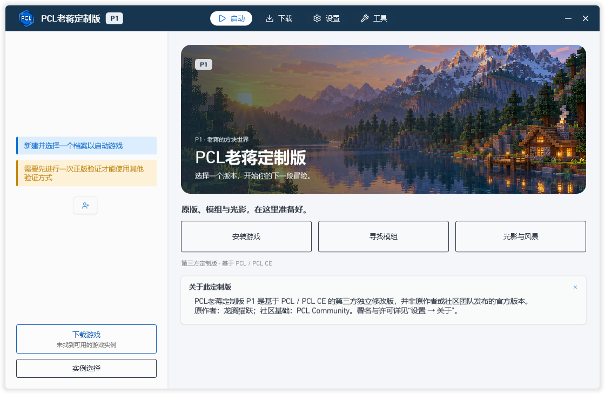

# PCL老蒋定制版 · P1

本项目基于锁定的 PCL CE v2.15.1 制作独立版本，显示名称为 **PCL老蒋定制版**，版本标识为 **P1**（内部版本 1.0.0-p1）。这不是 PCL 原作者或 PCL Community 发布的官方版本。

已实现独立数据目录、项目凭证、下载来源映射、中英文资源、安装流程接通和上游更新隔离。验证范围以 reports/acceptance-*.json 和 [实施记录](docs/实施记录.md) 为准，不能据此声称所有版本、加载器、账号和资源均已验证。

## 使用

安装包和便携版放在仓库的 **[Releases 页面](https://github.com/weienjiang0308-cyber/PCL-LaoJiang/releases/tag/p1)**，源码保存在本仓库；克隆源码不会下载安装包。P1 发布说明和验证范围见 [P1 开发预览版](docs/releases/P1.md)。

- [下载 Windows x64 安装包](https://github.com/weienjiang0308-cyber/PCL-LaoJiang/releases/download/p1/PCL-LaoJiang-P1-Setup.exe)
- [下载便携版](https://github.com/weienjiang0308-cyber/PCL-LaoJiang/releases/download/p1/PCL-LaoJiang-P1-Portable.zip)

双击 `artifacts/PCL老蒋定制版-P1-安装.exe` 打开图形安装程序，默认目录为 `D:\Games\PCL-LaoJiang`。安装后直接运行 `PCL老蒋定制版.exe`，无需 CMD、PowerShell 或另行安装 .NET 10。可选添加到 Windows 已安装应用，以及创建桌面快捷方式。

在当前工作区也可以直接双击根目录的 `PCL老蒋定制版.exe`，其数据写入 `sandbox/user`。安装版和便携版将游戏、存档、账号和缓存保存在各自目录的 `Data`，升级与卸载保留这些数据及本地凭证配置。

新主页使用 Minecraft 方块世界配图、P1 标识和游戏 / 模组 / 光影快捷入口，保留中英文切换。素材与提示词见 [P1 视觉素材说明](docs/P1-视觉素材说明.md)。

语言设置支持简体中文、English (US)、English (United Kingdom)，也可以跟随系统。下载来源在设置的游戏管理页选择，BMCLAPI 与 Mojang / 组件维护方分别标识。模组、光影和资源包直接使用 Modrinth；CurseForge 需要本项目获准使用的 API Key。

关于页面保留原作者龙腾猫跃和 PCL Community 的署名及赞助链接。窗口和启动提示显示第三方身份；开发版未配置独立在线更新服务。

## 登录和平台凭证

如已有本项目可用的凭证，将 config/credentials.example.json 复制为 config/credentials.local.json，填写 microsoftClientId 和/或 curseforgeApiKey，再双击 EXE 运行。也可设置进程环境变量：

- PCL_THIRDPARTY_MS_CLIENT_ID
- PCL_THIRDPARTY_CURSEFORGE_API_KEY

本地凭证配置已被 Git 忽略。不要填写账号密码、访问令牌或其他启动器的密钥。微软应用身份与 Minecraft 服务访问权限需要分别确认；仅填写 Client ID 不等于登录验收通过。

## 构建

所有命令从 D:\Codex\PCL-ThirdParty 执行。PowerShell：

    & .\scripts\Install-DotnetSdk.ps1
    & .\scripts\Build-Launcher.ps1 -Configuration Release -Publish
    & .\scripts\Build-Installer.ps1

安装程序和 EXE 入口的源码位于 `src/Packaging`。构建使用 Windows 自带的 .NET Framework 编译器；安装和运行不依赖这些开发脚本。安装器的文件哈希和清单见 `reports/installer-manifest.json`。

SDK 位于 work/tools/dotnet；NuGet、CLI、解包缓存和临时目录均由 scripts/Enter-ProjectEnvironment.ps1 指向项目 D 盘目录。不需要修改系统 .NET 或全局环境变量。global.json 固定项目 SDK。

参考源码保持在 work/upstream/pcl-ce；开发源码位于 src/PCL-ThirdParty。不要再次初始化已存在的开发源码。

## 验证

    & .\scripts\Test-Core.ps1
    & .\scripts\Test-Installer.ps1
    & .\scripts\Test-Launcher.ps1 -InstallVersion 1.20.1 -Source official -SandboxName vanilla-official-new
    & .\scripts\Test-Launcher.ps1 -InstallVersion 1.20.1 -Source mirror -FabricVersion auto -SandboxName fabric-mirror-new
    & .\scripts\Install-JavaRuntime.ps1 -MajorVersion 17

安装测试调用启动器本身的合并安装器和资源下载器，不是模拟安装实现。测试仅写入指定沙盒；跳过初次使用提示时不记录用户同意。auto 会随 Fabric 元数据变化，报告记录实际版本，复现时应使用该固定版本。

演示验证使用自建沙盒身份和 --demo，不验证正版账号，不复用现有登录缓存。报告分别记录下载、安装、演示启动和正版登录状态。

## 许可与发布范围

启动器主目录采用 PCL 自定义许可及合理使用指南，其余目录依据原许可和组件声明分别处理。不能将整个项目称为 Apache 2.0。详见 [第三方修改记录](src/PCL-ThirdParty/THIRD-PARTY-CHANGES.md)。当前产物为开发预览版，随附完整对应源码和原许可声明；尚未进行代码签名，也未建立独立在线更新服务。本仓库不扩大原许可授予的任何权利。

## English

**Plain Craft Launcher (PCL) Lao Jiang Custom Edition — P1** is an independent third-party development preview based on the pinned PCL CE v2.15.1 source. Original author: 龙腾猫跃 ([support the author](https://ifdian.net/a/LTCat)); community base: [PCL Community](https://github.com/PCL-Community/PCL-CE).

Download the Windows x64 installer or portable ZIP from this repository's **Releases** page when published. The installed launcher starts directly from an EXE and includes its .NET runtime. Chinese, English (US), and English (United Kingdom) are available in Settings. Updates and uninstall preserve the installation's `Data` directory.

Mojang official downloads and the BMCLAPI community mirror are identified separately. Modrinth is available without a project API key. Microsoft sign-in and CurseForge require this project's own approved credentials and have **not** been verified. The recorded game launch uses demo mode, not a paid account. See the [P1 release notes](docs/releases/P1.md) for the exact validation scope.

This is not an official release by PCL or PCL Community. Retain the original license and attribution; the launcher directory uses its own custom license and reasonable-use guide, so the repository must not be described as entirely Apache 2.0.

